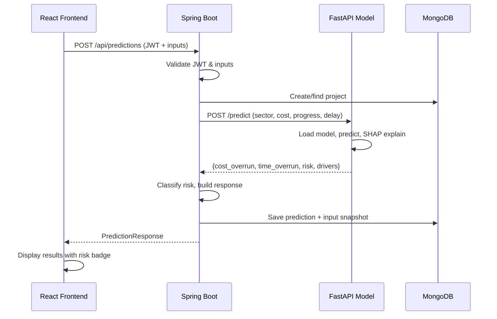

# Architecture — GovProject Risk Analytics

## System Overview

```
┌─────────────────┐     ┌──────────────────┐     ┌─────────────────┐     ┌──────────┐
│   React SPA     │────▶│  Spring Boot API  │────▶│ FastAPI Model   │     │ MongoDB  │
│   (Port 5173)   │◀────│  (Port 8080)      │◀────│ (Port 8000)     │     │ (27017)  │
└─────────────────┘     └──────────────────┘     └─────────────────┘     └──────────┘
                              │                                               ▲
                              └───────────────────────────────────────────────┘
```

## Components

### 1. Frontend (React + Vite)
- **Port:** 5173 (dev), proxies /api to 8080
- **Stack:** React 18, Vite, Tailwind CSS, React Router 6, Axios, Recharts, Lucide
- **Auth:** JWT stored in localStorage, attached via Axios interceptor
- **Pages:** Login, Dashboard, New Prediction, Results, Project Records, Details, Reports, Users

### 2. Backend (Spring Boot)
- **Port:** 8080
- **Stack:** Java 21, Spring Boot 3.4, Spring Security, Spring Data MongoDB
- **Auth:** JWT (HS256) with BCrypt password hashing
- **Roles:** ADMIN, OFFICER
- **API prefix:** `/api/`
- **Model integration:** RestTemplate calls to FastAPI service

### 3. Model Service (FastAPI)
- **Port:** 8000
- **Stack:** Python 3.12, FastAPI, uvicorn
- **Wraps:** Existing XGBoost prediction model
- **Endpoints:** POST /predict, GET /health, GET /model-info
- **SHAP:** Risk driver explanations per prediction

### 4. Database (MongoDB)
- **Collections:** users, projects, predictions, auditLogs
- **Indexes:** username (unique), projectId + officerId on predictions

## Data Flow — Prediction



## Security

- JWT tokens with 24h expiration
- BCrypt password hashing (strength 10)
- Role-based access: ADMIN can manage users, OFFICER can predict
- CORS restricted to frontend origin
- Input validation on all endpoints
- Audit logging for auth and prediction events

## Directory Structure

```
PREDICTION-MODEL/
├── frontend/          React SPA
├── backend/           Spring Boot API
├── model/             Python ML model + FastAPI
│   ├── data/          Training data (PDFs + CSV)
│   ├── models/        Saved model artifact (.pkl)
│   ├── src/           Model scripts (train, predict, explain)
│   ├── api.py         FastAPI inference service
│   └── tests/         Model tests
├── docs/              Documentation
├── docker-compose.yml Container orchestration
└── README.md          Setup guide
```

